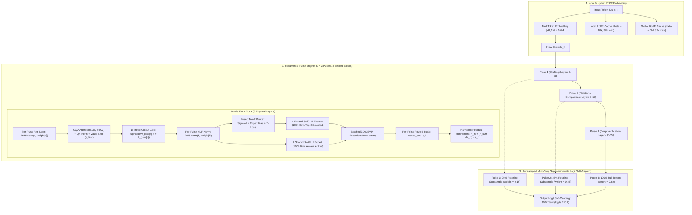

# Pulsar Architecture Specification: 8-Layer Recurrent Sparse MoE with 32k Hybrid Attention

- **Model Name:** Pulsar
- **Parameter Count:** **299.68M Total Parameters**
  - **Active Parameters per Token:** **147.92M parameters** (`97.59M` non-embedding active)
  - **Shared Parameters:** **98.35M parameters** (Embeddings, Attention, Shared Experts, Norms, Output Gates)
  - **Routed Expert Parameters:** **201.33M parameters** (8 Routed SwiGLU Experts per block)
  - **Sparsity Ratio:** **50.6% computational sparsity**
- **Effective Reasoning Depth:** 24 Layers ($K=3$ recurrent passes across an 8-layer physical core)
- **Context Length:** **32,768 Tokens** (32k context via Hybrid Local/Global Attention)
- **Target Deployment:** NVIDIA GeForce RTX 4060 Laptop GPU (8GB VRAM) / Single-GPU and Distributed nodes

---

## 1. Executive Summary & Core Architectural Invariants

Pulsar couples **recurrent compute efficiency** with **sparse Mixture-of-Experts (MoE)**, **harmonic residual refinement**, and **32k hybrid local/global attention**:

1. **Recurrent Depth Without Weight Rigidity:** An 8-layer physical Transformer core is looped recurrently $K=3$ times (yielding an effective reasoning depth of 24 layers). Unlike traditional recurrent networks where early feature extraction and late-stage verification compete over identical MLP parameters, Pulsar uses **Pulse-Indexed Routing**: tokens dynamically dispatch to different experts depending on recursion depth.
2. **Pulse-Indexed 16-Head Attention Output Gate:** Evaluated immediately after SDPA and before $W_o$, a per-pulse, per-head gating vector eliminates attention-sink noise by allowing heads to throttle output mass smoothly toward $0.0$, operating with **zero FlashAttention latency penalty**.
3. **Harmonic Per-Pulse Residual Refinement Scale:** Resolves the representation overwrite dilemma where recurrent updates previously dwarfed the base state ($\|\Delta \mathbf{h}\| \approx 150$ vs. $\|\mathbf{h}_{\text{in}}\| \approx 32$). Updates are scaled by learnable FP32 vectors $\mathbf{s}_k$ initialized harmonically to $1 / (k + 1)$ ($1.00 \to 0.50 \to 0.33$), yielding strictly monotonic contraction ($\|\Delta \mathbf{h}_1\| = 40.0 > \|\Delta \mathbf{h}_2\| = 18.6 > \|\Delta \mathbf{h}_3\| = 12.4$).
4. **Per-Pulse Routed-Expert Scale:** Scales the Top-2 routed expert contribution relative to the Always-On Shared Expert per pulse and channel, dynamically balancing general vs. specialized knowledge.
5. **DeepSeek-V3 Auxiliary-Loss-Free Global Balancing:** The router uses an expert bias vector $b \in \mathbb{R}^8$ to guide token distribution without adding artificial loss terms to the objective. Expert allocation counts are accumulated **globally across all 3 pulses**, allowing experts to specialize temporally (e.g. drafting vs. verification) while maintaining uniform hardware utilization.
6. **32k Hybrid Local/Global Attention Pattern:** 6 layers use high-precision local attention ($\theta = 10,000$, sliding window 1024), while 2 layers (Layers 3 & 7) provide global anchor attention ($\theta = 1,000,000$, full causal 32k span with YaRN temperature scaling). Across 3 recurrent pulses, the global layers execute 6 full 32k sweeps across sequence history.
7. **Fused Custom CUDA Kernels:** Critical bottlenecks (4-warp RMSNorm, QK-RMSNorm with grid-stride register accumulation, fused MoE Top-2 router + z-loss, and zero-copy SwiGLU) are executed through hand-optimized CUDA kernels in `csrc/kernels.cu`, delivering sustained Tensor Core saturation.

---

## 2. Architecture Diagram

---

## 3. Parameter & Geometry Specification

### 3.1 Dimensions & Hyperparameters

| Dimension / Setting | Value | Description |
| :--- | :---: | :--- |
| **Vocabulary Size ($V$)** | `49,152` | Byte-Level BPE with strict single-digit splitting |
| **Hidden Dimension ($d_{\text{model}}$)** | `1024` | Latent residual bus width (Pure Power-of-2) |
| **Physical Core Depth ($N_{\text{core}}$)** | `8` | Number of physical Transformer blocks |
| **Recurrent Passes ($K$)** | `3` (Default) | Effective reasoning depth: $8 \times 3 = \mathbf{24\text{ layers}}$ |
| **Max Supported Pulses** | `8` | Dynamically supports up to 64 effective layers |
| **Attention Query Heads ($H_Q$)** | `16` | Query dimension = $16 \times 64 = 1024$ |
| **Attention KV Heads ($H_{KV}$)** | `4` | Grouped-Query Attention (GQA, 4:1 ratio) |
| **Head Dimension ($d_{\text{head}}$)** | `64` | Dimension per attention head |
| **Attention Output Gating** | `16 Heads` | Pulse-indexed per-head gating vector ($\sigma(2.0) \approx 0.88$ init) |
| **Harmonic Residual Scaling** | `s_k ~ 1/(k+1)` | Channel-wise learnable scale per pulse ($1.0 \to 0.5 \to 0.33$) |
| **Expert FFN Dimension ($d_{\text{expert}}$)** | `1024` | SwiGLU expansion width ($1024 \to 2048 \to 1024$) |
| **Shared Experts per Block** | `1` | Always-active core reasoning expert |
| **Routed Experts per Block** | `8` | Dynamically selected specialized experts ($E0..E7$) |
| **Top-K Active Routed Experts** | `2` | Active routed experts selected per token |
| **Active FFN Width per Token** | `3072` | $1024\text{ (shared)} + 2 \times 1024\text{ (routed)}$ |
| **Context Length Support** | `32,768` | 32k context via hybrid local/global RoPE |
| **Local Attention Layers** | `0, 1, 2, 4, 5, 6` | $\theta = 10,000$, sliding window = 1024 |
| **Global Attention Layers** | `3, 7` | $\theta = 1,000,000$, full 32k causal span with YaRN |
| **Output Logit Soft-Capping** | `30.0` | $30.0 \times \tanh(\text{logits} / 30.0)$ |
| **Weight Tying** | `True` | `lm_head.weight = tok_emb.weight` |

### 3.2 Exact Parameter Breakdown

1. **Tied Token Embeddings & LM Head:**
   - $49,152 \times 1024 = \mathbf{50,331,648\text{ parameters}}$ (`50.33M`)
2. **8-Layer Physical Core:**
   - **Attention Projections (8 blocks):**
     - $W_{qkv}$ $[1024 \to 1536]$ (`1,572,864`) + $W_o$ $[1024 \to 1024]$ (`1,048,576`) = `2,621,440` per block
     - 8 blocks $\times 2,621,440 = \mathbf{20,971,520\text{ parameters}}$ (`20.97M`)
   - **16-Head Attention Output Gates (8 blocks):**
     - $W_{\text{gate}}$ $[8 \times 16 \times 1024] = 131,072$ params per block
     - $b_{\text{gate}}$ $[8 \times 16] = 128$ params per block
     - 8 blocks $\times 131,200 = \mathbf{1,049,600\text{ parameters}}$ (`1.05M`)
   - **Shared Core MLP (8 blocks):**
     - 1 Shared Expert per block: $W_{\text{gate\_up}}$ $[1024 \to 2048]$ (`2,097,152`) + $W_{\text{down}}$ $[1024 \to 1024]$ (`1,048,576`) = `3,145,728` per block
     - 8 blocks $\times 3,145,728 = \mathbf{25,165,824\text{ parameters}}$ (`25.17M`)
   - **8 Routed Experts MLP (8 blocks $\times$ 8 experts = 64 routed experts):**
     - Each routed expert: $W_{\text{gate\_up}}$ $[1024 \to 2048]$ + $W_{\text{down}}$ $[1024 \to 1024]$ = `3,145,728` params
     - 64 experts $\times 3,145,728 = \mathbf{201,326,592\text{ parameters}}$ (`201.33M`)
   - **Per-Pulse Scale, Norm, and Router Banks (8 blocks):**
     - QK-RMSNorm Scales: $8 \times [8 \times (16 \times 64 + 4 \times 64)] = 81,920$ params
     - Value Skip Blend Scales: $8 \times 8 = 64$ params
     - Layer RMSNorm Banks: $8 \times [2 \times 8 \times 1024] = 131,072$ params
     - Pulse-Indexed Routers: $8 \times [8 \times 8 \times 1024] = 524,288$ params
     - Per-Pulse Routed Expert Scales: $8 \times [8 \times 1024] = 65,536$ params
     - Router Biases: $8 \times 8 = 64$ params
     - Subtotal: $\mathbf{802,944\text{ parameters}}$ (`~0.80M`)
3. **Conditioning & Output Norms:**
   - Harmonic Residual Scale (`pulse_res_scale` $[8 \times 1024]$): $8,192$ params
   - Pulse Step Embeddings: $8 \times 1024 = 8,192$ params
   - Unit-Normalized Pre-Mix Norms (`pulse_state_norm` + `anchor_norm`): $2 \times 1024 = 2,048$ params
   - Input Mix Logits (`input_mix_logit` $[8 \times 1024]$): $8,192$ params
   - Final RMSNorm: $1024$ params
   - Subtotal: $\mathbf{27,648\text{ parameters}}$
4. **Grand Total Parameters:**
   $$\mathbf{50,331,648 + 20,971,520 + 1,049,600 + 25,165,824 + 201,326,592 + 802,944 + 27,648 = 299,675,776\text{ params}}\quad (\mathbf{\approx 299.68M})$$

---

## 4. Attention & RoPE Geometry

### 4.1 32k Hybrid Local/Global Attention
- **Local Layers (Layers 0, 1, 2, 4, 5, 6):**
  - High-frequency base $\theta_{\text{local}} = 10,000.0$ for sharp local positional resolution.
  - Causal sliding window of $1024$ tokens.
- **Global Anchor Layers (Layers 3 and 7):**
  - Ultra-high wavelength base $\theta_{\text{global}} = 1,000,000.0$ ($1\text{M}$) allowing representation across 32,768 tokens.
  - Full causal span with YaRN temperature scaling:
    $$q \leftarrow q \cdot \left(1.0 + 0.1 \cdot \ln\frac{T}{1024}\right)\quad \text{when } T > 1024$$
  - Across $K=3$ recurrent pulses, Layers 3 and 7 execute **6 full global causal sweeps** across sequence history.

### 4.2 Pulse-Indexed 16-Head Output Gate
After computing attention via SDPA, each head is dynamically gated:
$$\mathbf{g}_k = \sigma(\mathbf{x}\mathbf{W}_{\text{gate}}[k]^\top + \mathbf{b}_{\text{gate}}[k]) \in \mathbb{R}^{B \times T \times 16}$$
$$\mathbf{out}_{\text{gated}}[:, h, :, :] = \mathbf{out}[:, h, :, :] \cdot \mathbf{g}_k[:, :, h, \text{None}]$$
$$\mathbf{y} = \mathbf{W}_o(\text{reshape}(\mathbf{out}_{\text{gated}}))$$

### 4.3 Per-Pulse, Per-Head QK-RMSNorm
Attention logits are bounded natively via Cauchy-Schwarz before rotary embeddings:
$$q_{\text{normed}} = \text{RMSNorm}(q) \odot \gamma_Q[k, h]$$
$$k_{\text{normed}} = \text{RMSNorm}(k) \odot \gamma_K[k, h_{\text{kv}}]$$
where $\gamma_Q \in \mathbb{R}^{K_{\text{max}} \times H_Q \times d_{\text{head}}}$ and $\gamma_K \in \mathbb{R}^{K_{\text{max}} \times H_{KV} \times d_{\text{head}}}$ are FP32 scale parameters initialized to `1.0`.

### 4.4 Value-Residual Skip Connection ($v_{\text{first}}$)
- In Layer 0 of Pulse 0, the initial value projection is captured: $v_{\text{first}} = W_v \cdot x$
- In all subsequent layers and pulses, $v_{\text{first}}$ is blended into the current layer's value projection:
  $$\lambda_v = \sigma(\theta_v[k])$$
  $$v \leftarrow (1 - \lambda_v) v + \lambda_v v_{\text{first}}$$
  where $\theta_v$ is initialized to `-2.2` ($\lambda_v \approx 0.10$).

---

## 5. Recurrent Sparse MoE Engine

### 5.1 DeepSeek-V3 Auxiliary-Loss-Free Bias Balancing
1. **Pulse-Indexed Router:**
   $$s_i = \sigma(W_{\text{router}}[k]_i \cdot x_{\text{flat}}), \quad i \in \{0, \dots, 7\}$$
2. **Biased Selection:**
   $$\text{Top-}2 = \operatorname{argtop2}_{i} (s_i + b_i)$$
3. **Unbiased Gating:**
   $$g_i = \frac{s_i}{\sum_{j \in \text{Top-}2} s_j}, \quad i \in \text{Top-}2$$
4. **Global Across-Pulse Load Balancing:**
   Expert assignments are accumulated globally across all micro-batches and all $K=3$ pulses. After each optimizer step:
   $$b_i \leftarrow b_i + 0.001 \cdot \operatorname{sign}(\bar{C} - C_i), \quad b_i \in [-0.5, 0.5]$$
5. **Per-Pulse Routed Expert Scaling:**
   $$y = \text{SharedExpert}(x) + \text{RoutedCombine}(x) \odot \mathbf{r}_k$$

---

## 6. Training Dynamics & Optimizer Partitioning

- **Target Hardware Architecture:** Modern Tensor Core GPUs (NVIDIA Ada Lovelace, Hopper, Blackwell, Ampere).
- **Dual Optimizer Architecture (`PulsarDualOptimizer`):**
  - **Muon ($lr = 0.02, \text{momentum} = 0.95, \text{wd} = 0.1$):**
    - 2D Core Attention and MLP matrices ($W_{qkv}, W_o, W_{\text{shared}}$).
    - Shape-grouped batched Muon across all 64 routed expert matrices (`[64, 1024, 2048]` and `[64, 1024, 1024]`).
  - **AdamW ($lr = 6 \times 10^{-4}, \beta_1 = 0.9, \beta_2 = 0.95, \text{wd} = 0.0$):**
    - `tok_emb`, `pulse_step_emb`, `router_weight`, `attn_gate`, `attn_gate_bias`, `pulse_res_scale`, `routed_scale`, and all 1D RMSNorm scale parameters (strictly preserved in FP32).
