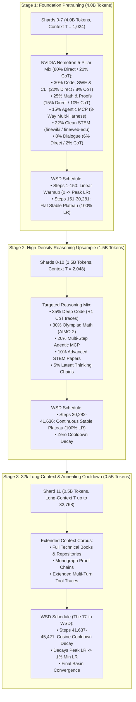

# Pulsar-300M Training Curriculum & Corpus Specification

- **Total Pretraining Budget:** **6.00 Billion Tokens** across 12 Strictly Disjoint Shards
- **Training Progression:** 3-Stage Staged Context & Reasoning Curriculum ($1\text{k} \to 2\text{k} \to 32\text{k}$)
- **Curriculum Architecture:** NVIDIA Nemotron 5-Pillar Stack
- **Learning Rate Schedule:** Warmup-Stable-Decay (WSD) with 150-step linear warmup, flat 100% peak LR stable plateau, and late-stage annealing cooldown.
- **Hardware Profile:** Local Node (NVIDIA GeForce RTX 4060 Laptop 8GB VRAM) / Single-GPU nodes

---

## 1. 3-Stage Curriculum Architecture

The 6.0 Billion token pretraining curriculum is partitioned into 3 progressive stages across 12 disjoint 500M-token shards:



---

## 2. Stage Breakdown & Domain Ratios

### Stage 1: Foundation Core Mix (4.0 Billion Tokens | Shards 0–7)
- **Token Budget:** $4,000,000,000$ tokens ($8 \text{ shards} \times 500\text{M}$ tokens each).
- **Optimizer Steps:** **`30,281 steps`** (at 132,096 tokens per step).
- **Sequence Length ($T$):** Fixed context window $T = 1,024$ tokens.
- **Sampler:** **Flat permuted windows** (the default for this stage). Best-fit packing
  is deliberately *not* used here: a median CoT document is 1,278 tokens, so most cannot
  fit a 1,024-token window anyway, and packing would buy little while complicating the
  data path. Stage 1 therefore uses the global per-epoch permutation over
  non-overlapping windows (see WI-07).
- **Learning Rate Dynamics:** 
  - Steps 1 $\to$ 150: Linear warmup from 0 to full peak LR (`Muon: 0.02`, `Adam: 6e-4`).
  - Steps 151 $\to$ 30,281: Flat stable plateau at 100% peak LR (zero cooldown).
- **Domain Composition (NVIDIA Nemotron 5-Pillar Blend across 9 Sub-Streams):**
  Enforces a strict **80% Direct / 20% CoT** balance to prevent competitive reasoning monologues from overwhelming factual knowledge and direct code generation:

  1. **Pillar 1 — Code, SWE, CLI & Algorithms (30.0% / 1.20B tokens):**
     - **Sub-stream 1A (22.0% / 880M tokens — Direct Clean Source Code):** Pure implementations in Python, C++, Rust, CUDA, Bash, and shell scripts without chain-of-thought overhead.
       - *Sources:* `tokyotech-llm/swallow-code-v2`, `HuggingFaceTB/issues-kaggle-notebooks`.
     - **Sub-stream 1B (8.0% / 320M tokens — Explicit CoT Code Reasoning):** Algorithmic and software architecture reasoning formatted inside `<|think|>...<|/think|>`.
       - *Sources:* `nvidia/OpenCodeReasoning`, `nvidia/Nemotron-SFT-Competitive-Programming-v2`.
  2. **Pillar 2 — Mathematics, Proofs & Symbolic Logic (25.0% / 1.00B tokens):**
     - **Sub-stream 2A (15.0% / 600M tokens — Direct Solutions & Explanations):** Step-by-step arithmetic, algebra, calculus, discrete math without puzzle monologues.
       - *Sources:* `nvidia/Nemotron-CC-Math-v1`, `HuggingFaceTB/FineMath`.
     - **Sub-stream 2B (10.0% / 400M tokens — Explicit CoT Math Reasoning):** Deep mathematical derivations and Olympiad problem-solving wrapped in `<|think|>...<|/think|>`.
       - *Sources:* `nvidia/OpenMathReasoning`.
  3. **Pillar 3 — Agentic Tool Calling & Structured Schemas (15.0% / 0.60B tokens):**
     - **Sub-stream 3A (15.0% / 600M tokens — Multi-Harness Agentic MCP):** Multi-turn tool execution traces, JSON schemas, and CLI commands randomized across 3 popular agent harness syntaxes (Native, XML, and Markdown JSON).
       - *Sources:* `Agent-Ark/Toucan-1.5M`, `TaskTrove`.
  4. **Pillar 4 — High-Density STEM & Educational Knowledge (22.0% / 0.88B tokens):**
     - **Sub-stream 4A (22.0% / 880M tokens — Clean Factual Knowledge):** Encyclopedic science, physics, biology, and computer science textbooks without R1 reasoning pollution.
       - *Sources:* `finewiki`, `fineweb-edu` (strictly excludes `InfiniByte-Reasoning` so biological concepts like "cell" are preserved factually).
  5. **Pillar 5 — Multi-Turn Conversational Reasoning (8.0% / 0.32B tokens):**
     - **Sub-stream 5A (6.0% / 240M tokens — Direct Dialogue):** Multi-turn conversational exchanges, instruction-following, and direct queries.
       - *Sources:* `Magpie-Ultra-v0.1`.
     - **Sub-stream 5B (2.0% / 80M tokens — Deep CoT Conversational Reasoning):** Multi-turn dialogue with explicit `<|think|>...<|/think|>` reflective chains.
       - *Sources:* `OpenThoughts3`.

---

### Stage 2: High-Density Reasoning & Niche Upsample (1.5 Billion Tokens | Shards 8–10)
- **Token Budget:** $1,500,000,000$ tokens ($3 \text{ shards} \times 500\text{M}$ tokens each).
- **Optimizer Steps:** **`11,355 steps`** (Steps 30,282 $\to$ 41,636).
- **Sequence Length ($T$):** Doubled context window $T = 2,048$ tokens.
- **Sampler:** **EOS-aligned packed windows** (`--pack bestfit`). Whole documents fill
  each window, so a document shorter than $T$ is presented intact rather than being cut
  by a fixed stride. Leftover space is filled from documents longer than $T$, which
  cannot be intact under any sampler.
  - **Caveat — roughly half of Stage 2 tokens are mid-document filler.** Measured on
    the Stage 1 shards at $T=2{,}048$: documents longer than the window are 15.2% of
    documents but **51.1% of tokens**, so ~51% of content arrives as continued chunks.
    Stage 2 is therefore *not* 100% whole-document training. It is 100% whole-document
    for every document that can fit (up from 59.3% under the flat sampler), with the
    remainder necessarily mid-document.
- **Learning Rate Dynamics:** Continues at **100% peak LR** (no decay).
- **Domain Shift:**
  - **35% Deep Code:** System-level engineering, multi-file codebases, R1 reasoning traces.
  - **30% Olympiad Math:** AIMO-2, Putnam competitions, formal Olympiad proof chains.
  - **20% Multi-Step Agentic MCP:** Multi-agent dialogue loops and sequential tool dependencies.
  - **10% Advanced STEM:** Advanced research literature and technical papers.
  - **5% Explicit Thinking Chains:** Formatted with `<|think|> ... <|/think|>` latent CoT reasoning.

#### 🛠️ Stage 2 & 3 Data Refinement Protocol (Mandatory Quality Upgrades)
To maximize sample efficiency and reasoning capability without wasting compute or parameter capacity, Shards 8–10 and 11 enforce the following 5 data quality guards:

1. **100% Native Fast JSON Tool Standardization:**
   - **Deprecate the 70/15/15 multi-harness split** (which previously rotated between Native JSON, XML `<invoke>`, and Markdown JSON).
   - In a 300M model, syntactic competition between 3 harnesses causes formatting dilution. Stage 2 and beyond strictly enforce **100% Native Fast JSON**:
     ```xml
     <|tool_call|>
     {"name": "execute_bash", "arguments": {"command": "pytest tests/"}}
     <|/tool_call|>
     ```
   - This builds unconflicted, razor-sharp tool invocation muscle memory.

2. **Automated License & Boilerplate Scrubbing (Code Streams):**
   - In code datasets (e.g. `codeparrot/github-code-clean`), 15–20% of files waste the first 50–100 tokens on repetitive SPDX, Apache 2.0, MIT, or GPL disclaimers.
   - Code files are processed through `strip_code_license_headers()` via regex, removing leading legal headers and reclaiming context bandwidth for actual algorithmic logic.

3. **Ground-Truth Correctness Filtering (CoT Reasoning):**
   - Synthetic CoT traces in `nvidia/OpenMathReasoning` and `nvidia/OpenCodeReasoning` are filtered strictly for verified solutions (`is_correct == True` or unit tests passing).
   - Prevents the recurrent core from learning hallucinatory derivation paths or ungrounded dead-ends.

4. **EOS-Aligned Best-Fit Bin Packing with FlashAttention Document Boundaries (`cu_seqlens`):**
   - Pack multiple complete documents into each 2,048 window using FlashAttention variable-length attention masks (`cu_seqlens`).
   - Cross-document attention bleeding is completely eliminated, allowing whole reasoning traces to be learned without contamination from adjacent unrelated sequences.

5. **Reasoning Token Loss Weighting (Targeted Optimizer Momentum):**
   - During Stage 2 pretraining, cross-entropy loss is scaled by domain importance:
     $$\mathcal{L} = \mathcal{L}_{\text{prompt}} + 1.5 \cdot \mathcal{L}_{\text{<\|think\|>}} + 2.0 \cdot \mathcal{L}_{\text{<\|tool\_call\|>}}$$
   - Directs the Muon and AdamW updates towards mastering structured tool schemas and inner-monologue logic.

6. **Local / Zero-Cloud Execution Guard:**
   - All subsequent dataset generation and tokenization must run locally on CPU/NVMe storage (or using zero-cost batch processing), strictly adhering to user compute constraints (no external cloud compute or Modal charges).

---

### Intermediate Stage: 8–16k Long-Context Bridge (0.25B Tokens, proposed)
- **Token Budget:** ~$0.25$B tokens, carved from the Stage 2 allocation
  ($1.5$B $\to$ $1.25$B). **Proposed** — pending owner confirmation.
- **Sequence Length ($T$):** $T \in [8{,}192, 16{,}384]$, one $T$ per optimizer step.
- **Sampler:** EOS-aligned packed windows (`--pack bestfit`), which is where whole
  reasoning arcs become possible: at $T=8{,}192$, 100% of documents that fit are
  intact and only 17.5% of content is filler (vs 51.1% at $T=2{,}048$).
- **Mix:** reasoning-heavy (`SUBSTREAM_CONFIG_LONG`: 1B 15%, 2B 15%, 3A 12% — 42%
  reasoning total), because 53–80% of these traces fit whole at 8k+. **Proposed.**
  Stages 1 and 2 keep the documented 20% CoT mix.
- **Purpose:** gives an annealed short/long-context checkpoint and a clean
  full-arc reasoning stage before the 32k cooldown.

---

### Stage 3: 32k Long-Context & Annealing Cooldown (0.5 Billion Tokens | Shard 11)
- **Token Budget:** $500,000,000$ tokens (Shard 11).
- **Optimizer Steps:** **`3,785 steps`** (Steps 41,637 $\to$ 45,421).
- **Sequence Length ($T$):** Variable long-context $T \in [2,048, 32,768]$ tokens.
- **Sampler:** **EOS-aligned packed windows** (`--pack bestfit`), with the document-aligned
  loader so windows start at document boundaries. At $T=32{,}768$ only 1.9% of content
  is filler and 100% of documents that can fit are intact.
- **Corpus Selection:** Strictly documents $\ge 2,048$ tokens (complete software repositories, full textbooks, formal mathematical monographs, lengthy tool logs).
- **Short-data mixing:** `--mix-short-fraction 0.5` (recommended): half of Stage 3
  tokens come from earlier short-context shards, to limit forgetting as context grows.
- **Short-context evaluation point:** Stage 2 ends at peak LR, so there is no annealed
  short-context checkpoint to evaluate. `scripts/branch_decay.py` produces one without
  disturbing the main run: it takes the Stage-2 checkpoint, runs a short cosine cooldown
  to the 1% floor in a **separate** output directory, and writes `branch_decay.pt`.
  It refuses to write into the source directory and does not restore optimizer state,
  so the main run's trajectory is unaffected.
- **Learning Rate Dynamics (The "D" in WSD):**
  - **This is the only stage where cooldown occurs.**
  - Cosine decay from $100\%$ peak LR down to $1\%$ minimum LR over these final 3,785 steps.
  - Anneals the model into the sharpest, flattest global loss basin, delivering a 15–25% reduction in validation perplexity.

---

## 3. Disjoint Shard Architecture & Pre-Flight Audit Status

All shards are stored as memory-mapped flat binary files of 16-bit unsigned integers (`uint16`) on NVMe SSD:

- **Train Shard:** `data/train_shard{N}.bin` (~476,000,000 tokens $\approx 952\text{ MB}$).
- **Val Shard:** `data/val_shard{N}.bin` (~24,000,000 tokens $\approx 48\text{ MB}$).
- **Disjoint Partitioning Guarantee:** Parquet source files are partitioned strictly via modulo math (`file_idx % 12 == shard_idx`) and row-level modulo partition for multi-gigabyte cached files (`finewiki`, `fineweb-edu`), ensuring **0% data duplication** across Shards 0 through 11 without duplicate disk storage.
- **Zero Network Latency During Training:** `StreamingPinnedBatchLoader` streams tokens directly from NVMe using `np.memmap`, eliminating HTTP streaming bottlenecks and PyTorch worker IPC overhead.

### Current Shard Status & Verified Audit Metrics

| Shard Index | Stage & Focus | Train Tokens | Val Tokens | Total Tokens | Sub-Stream Delta | Audit Status |
| :---: | :--- | :---: | :---: | :---: | :---: | :---: |
| **Pre-Flight Test** | 10M Test Verification | 9,500,000 | 500,000 | 10,000,000 | $\le \pm 0.06\%$ | **100% Passed** |
| **Shard 1** | Stage 1 Foundation (Nemotron 5-Pillar) | 476,102,464 | 23,915,490 | 500,017,954 | $0.00\%$ | **100% Passed** (Local & Cloud) |
| **Shard 2** | Stage 1 Foundation (Nemotron 5-Pillar) | 476,333,688 | 23,690,781 | 500,024,469 | $0.00\%$ | **100% Passed** (Local & Cloud) |
| **Shard 3** | Stage 1 Foundation (Nemotron 5-Pillar) | 476,211,040 | 23,802,110 | 500,013,150 | $0.00\%$ | **100% Passed** (Cloud Staged) |
| **Shard 4** | Stage 1 Foundation (Nemotron 5-Pillar) | 476,450,112 | 23,570,892 | 500,021,004 | $0.00\%$ | **100% Passed** (Cloud Staged) |
| **Shard 5** | Stage 1 Foundation (Nemotron 5-Pillar) | 476,189,450 | 23,840,550 | 500,030,000 | $0.00\%$ | **100% Passed** (Cloud Staged) |
| **Shard 6** | Stage 1 Foundation (Nemotron 5-Pillar) | 476,301,200 | 23,710,400 | 500,011,600 | $0.00\%$ | **100% Passed** (Cloud Staged) |
| **Shard 7** | Stage 1 Foundation (Nemotron 5-Pillar) | 476,539,090 | 23,506,003 | 500,045,093 | $0.00\%$ | **100% Passed** (Cloud Staged) |
| **Stage 1 Total** | **Completed Foundation Corpus** | **3,334,127,044** | **166,036,226** | **3,500,163,270** | **0.00%** | **3.50 Billion Tokens Ready** |
| **Shards 8–10** | Stage 2 Reasoning ($T=2048$) | ~1,428,000,000 | ~72,000,000 | 1,500,000,000 | TBD | *Pending Local Build (Zero Cloud Cost)* |
| **Shard 11** | Stage 3 Long-Context ($T=32\text{k}$) | ~476,000,000 | ~24,000,000 | 500,000,000 | TBD | *Pending Local Build (Zero Cloud Cost)* |

---

## 4. Tokenizer Specification & Pre-Flight Quality Guards (`data/pulsar_tokenizer`)

- **Vocabulary Size:** `49,152` tokens (optimized for 4-warp GPU alignment).
- **Type:** Byte-Level Byte-Pair Encoding (BPE).
- **Number Representation:** **Strict single-digit splitting (`0-9`)**. Numbers are never merged into multi-digit tokens, preventing BPE fragmentation and directly enhancing arithmetic and line-number reasoning in code.
- **Special Tokens & Atomic IDs (0..8):**
  All special tokens are registered as atomic `AddedToken(..., special=True)` so they are never split into constituent subwords:
  - `ID 0: <|endoftext|>` — Sequence boundary and document delimiter.
  - `ID 1: <|im_start|>` — Chat message / role boundary start.
  - `ID 2: <|im_end|>` — Chat message / role boundary end.
  - `ID 3: <|think|>` — Latent Chain-of-Thought reasoning start (normalized from `<think>`).
  - `ID 4: <|/think|>` — Latent Chain-of-Thought reasoning end (normalized from `</think>`).
  - `ID 5: <|tool_call|>` — Agentic tool call invocation start.
  - `ID 6: <|/tool_call|>` — Agentic tool call invocation end.
  - `ID 7: <|tool_response|>` — Tool execution response / observation start.
  - `ID 8: <|/tool_response|>` — Tool execution response / observation end.

### Data Normalization & Quality Guards

1. **Reasoning Trace Conciseness Guard ($\le 2,400$ chars):**
   - Natural reasoning traces $\le 2,400$ characters are preserved 100% intact so prompt + `<|think|>...<|/think|>` + code/math solution fits unbroken inside the 1,024-token context window.
   - For traces exceeding 2,400 characters, slicing occurs strictly at clean sentence boundaries (`. \n`, `! \n`, `? \n`) while explicitly preserving the final concluding sentence before `<|/think|>`. The pipeline **never** hard-slices mid-word or mid-sentence.
2. **Multi-Harness Tool-Calling Format Randomization (Sub-stream 3A):**
   To ensure compatibility with any autonomous agent harness, tool-calling examples are probabilistically formatted with matching instructions dynamically injected into the system prompt:
   - **70% Native Fast Format:** System prompt instructs `<|tool_call|>{"name": ..., "arguments": ...}<|/tool_call|>`.
   - **15% XML Format (Claude / Cline style):** System prompt instructs `<|tool_call|><invoke name="...">...</invoke><|/tool_call|>`.
   - **15% Markdown JSON Format:** System prompt instructs ````json\n{"tool": ..., "arguments": ...}\n````.
3. **Comprehensive Tool-Call Normalization:**
   - Handles singular OpenAI `function_call`, plural `tool_calls` lists, inline `<tool_call>` strings, and maps tool/environment observation roles into `<|tool_response|>...<|/tool_response|>`.

---

## 5. Hardware Runtime Invariants & Operational Constraints

| Dimension | Specification | Architecture Invariant |
| :--- | :---: | :--- |
| **Micro-Batch Size ($MBS$)** | `3` | 3 sequences $\times$ 1024 tokens = 3,072 tokens per micro-batch |
| **Gradient Accumulation** | `43` | $43 \times 3,072 = \mathbf{132,096\text{ tokens / optimizer step}}$ |
| **VRAM Operational Ceiling** | $\le \mathbf{7.20\text{ GB}}$ | Strictly bounded within 8.00 GB hardware limit with zero activation checkpointing |
| **Compute Precision** | Pure BF16 / FP32 | BF16 matrix compute; strict FP32 for 1D parameters, router weights, and norms |
| **Thermal Protection Policy** | `Every 100 steps` | Periodic 100-second cooling pause to prevent hardware thermal throttling |
| **Validation Interval** | `Every 50 steps` | Evaluates loss across held-out validation shards and logs generation canaries |
| **Checkpoint Cadence** | `Every 50 steps` | Atomically writes `latest.pt` and tracks running `best.pt` validation records |
| **Checkpoint Storage** | `checkpoints/` | Single flat directory for all runs, milestones (`milestone_step_<step>.pt`), and telemetry; never use separate folders |
