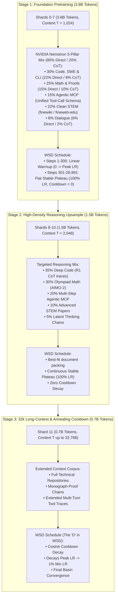

# Pulsar-300M Training Curriculum & Corpus Specification

- **Total Pretraining Budget:** **6.00 Billion Tokens** across 12 Strictly Disjoint Shards
- **Training Progression:** 3-Stage Staged Context & Reasoning Curriculum ($1\text{k} \to 2\text{k} \to 32\text{k}$)
- **Curriculum Architecture:** NVIDIA Nemotron 5-Pillar Stack
- **Learning Rate Schedule:** Warmup-Stable-Decay (WSD) with 300-step linear warmup, flat 100% peak LR stable plateau, and late-stage annealing cooldown.
- **Hardware Profile:** NVIDIA B300 SXM6 (Blackwell Ultra), B200, H200, H100 via Modal / Local RTX 4060 validation

---

## 1. 3-Stage Curriculum Architecture

The 6.0 Billion token pretraining curriculum is partitioned into 3 progressive stages across 12 disjoint shards:



---

## 2. Stage Breakdown & Domain Ratios

### Stage 1: Foundation Core Mix (3.8 Billion Tokens | Shards 0–7)
- **Token Budget:** $3,800,000,000$ tokens ($8 \text{ shards} \times 475\text{M}$ tokens each).
- **Optimizer Steps:** **`28,991 steps`** (at 131,072 tokens per step).
- **Sequence Length ($T$):** Fixed context window $T = 1,024$ tokens.
- **Batch Dynamics:**
  - Micro-Batch Size (MBS): 128
  - Gradient Accumulation Steps: 1
  - Effective Global Batch Tokens: $128 \times 1024 = 131,072$ tokens / step.
- **Sampler:** **Flat permuted windows** (default for Stage 1). Best-fit packing is reserved for Stage 2, where the 2,048-token context comfortably fits median CoT documents (p50: 1,278 tokens).
- **Learning Rate Schedule:**
  - Steps 1 $\to$ 300: Linear warmup from 0 to full peak LR (`Muon: 0.02`, `Adam: 6e-4`).
  - Steps 301 $\to$ 28,991: Flat stable plateau at 100% peak LR (`cooldown_steps = 0`).
- **Domain Composition (80% Direct / 20% CoT):**
  1. **Pillar 1 — Code, SWE, CLI & Algorithms (30.0% / 1.14B tokens):**
     - Sub-stream 1A (22.0% / 836M tokens): Direct clean source code in Python, C++, Rust, CUDA, Bash without CoT overhead.
     - Sub-stream 1B (8.0% / 304M tokens): Algorithmic reasoning formatted inside `<|think|>...<|/think|>`.
  2. **Pillar 2 — Mathematics, Proofs & Symbolic Logic (25.0% / 0.95B tokens):**
     - Sub-stream 2A (15.0% / 570M tokens): Direct step-by-step arithmetic, algebra, calculus, and discrete math.
     - Sub-stream 2B (10.0% / 380M tokens): Deep mathematical derivations and Olympiad problem-solving wrapped in `<|think|>...<|/think|>`.
  3. **Pillar 3 — Agentic Tool Calling & Structured Schemas (15.0% / 0.57B tokens):**
     - Multi-turn tool execution traces using the unified schema:
       `<|tool_call|>{"name": ..., "arguments": ...}<|/tool_call|>`
     - High-density tool invocations with strict JSON schema compliance.
  4. **Pillar 4 — Clean STEM & Educational Knowledge (22.0% / 0.836B tokens):**
     - Encyclopedic science, physics, biology, and computer science textbooks without reasoning pollution.
  5. **Pillar 5 — Multi-Turn Conversational Reasoning (8.0% / 0.304B tokens):**
     - Instruction-following, conversational exchanges, and dialogue.

---

## 3. Tool Calling & Reasoning Trace Standards

### 3.1 Unified Tool Calling Format
All tool calls adhere strictly to a single schema:
```
<|tool_call|>{"name": "function_name", "arguments": {"arg1": "val1"}}<|/tool_call|>
```
Measured over the corpus: 100,914 balanced open/close tags with zero syntax divergence.

### 3.2 Verbatim Reasoning Traces
Reasoning traces are preserved in their entirety:
- `<|think|>` traces are stored intact without artificial ellipses (`\n\n[...]\n\n`).
- Measured over the corpus: 114,893 balanced pairs and zero synthetic elisions.
- Preserves natural thought progression from problem formulation to verification.
