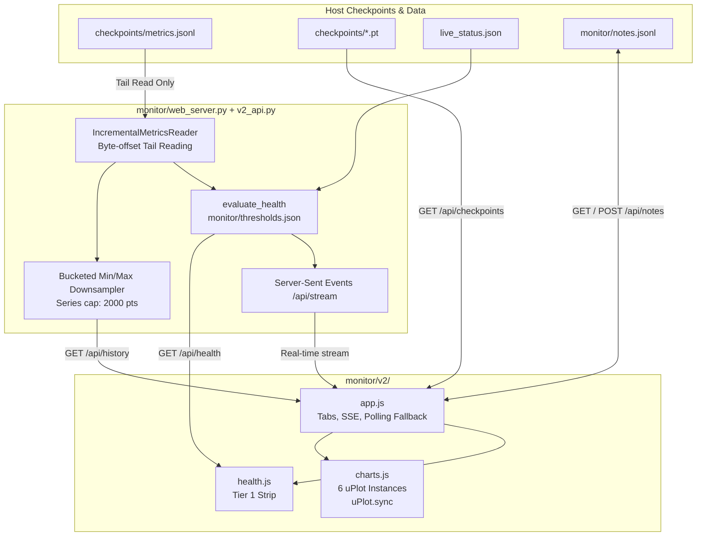

# PULSAR-300M Monitor V2 Specification & Architecture

## 1. Overview & Mission

The PULSAR Training Monitor V2 (`monitor/v2/`, served live at `/v2`) provides real-time, zero-disturbance operational visibility into the PULSAR-300M pretraining run.

It solves the seven fundamental design flaws of the legacy monitor:
1. **Comparable Learning Metrics**: Separates the auxiliary weighted training sum (`train_loss`, which includes z-loss and 25% subsampled intermediate pulses) from the **final-pulse training cross-entropy** (`pulse_losses[-1]`), plotting it directly against validation final cross-entropy (`val_ce_final`).
2. **Clear Information Hierarchy**: Elevates run health to an always-visible **Tier 1 Sticky Health Strip** (`OK` / `WATCH` / `ALERT`), followed by **Tier 2 Focused Charts** and **Tier 3 Drill-Down Tabs**.
3. **Automated Server-Side Thresholds**: 9 automated health checks evaluated against configurable parameters in [`monitor/thresholds.json`](file:///home/yashwanth/projects/pulsar-300m/monitor/thresholds.json).
4. **Scalable Downsampling**: An incremental tail-reader with bucketed min/max downsampling ensures browser payloads remain $< 50\text{ KB}$ and chart points $\le 2000$, even across 45,000+ steps.
5. **Zero CDN Dependencies**: All styling, font fallbacks, and charting libraries ([`uPlot.iife.min.js`](file:///home/yashwanth/projects/pulsar-300m/monitor/v2/vendor/uPlot.iife.min.js), [`uPlot.min.css`](file:///home/yashwanth/projects/pulsar-300m/monitor/v2/vendor/uPlot.min.css)) are strictly vendored locally for 100% offline reliability.
6. **First-Class Diagnostics**: Exposes recurrent pulse gain ($\Delta L = L_{p1} - L_{p3}$), MoE token drops, router bias drift, and hidden-state contraction ($\|\Delta h\|$).
7. **Timeline Events & Notes**: In-memory and persistent note tracking via [`monitor/notes.jsonl`](file:///home/yashwanth/projects/pulsar-300m/monitor/notes.jsonl).

---

## 2. Information Architecture

### Tier 1: Sticky Health Strip
Always pinned at the top of the viewport (fully responsive, switching from 9 columns on desktop to 2 columns on mobile):

| Health Check | Metric Evaluated | Nominal / Thresholds | Failure Status |
|---|---|---|---|
| **Run State** | Heartbeat vs median step time | $< 3.0\times$ median step time | `ALERT` if stalled |
| **Progress / ETA** | Current step vs target horizon | Wall-clock linear ETA | Nominal |
| **Loss & Gap** | $|Tr_{\text{final}} - Val_{\text{final}}|$ | Overfit / underfit gap $\le \pm 0.15\text{ nats}$ | `WATCH` |
| **Gradients** | Norm Total & Clip Fraction | Rolling 100-step clip fraction $\le 30\%$ | `WATCH` |
| **Throughput** | Tokens/sec & Peak VRAM | Tok/s $\ge 8,500$ floor; VRAM $\le 7.5\text{ GB}$ | `WATCH` / `ALERT` |
| **MoE Drops** | Actual drop rate % | $\le 2.0\%$ OK; $2.0\% - 5.0\%$ WATCH; $> 5.0\%$ ALERT | `WATCH` / `ALERT` |
| **MoE Skew** | Worst expert share & $\|bias\|$ | Worst share $\le 25\%$ (Alert $> 35\%$); $\|bias\| \le 0.3$ | `WATCH` / `ALERT` |
| **Recurrent Loops** | Latent Gain ($L_{p1} - L_{p3}$) | $\Delta L > 0.01$ (Refinement paying off) | `WATCH` |
| **Numerics** | NaN / Inf occurrence | 0 occurrences in loss or gradients | `ALERT` |

### Tier 2: 6 Focused uPlot Charts (Synchronized Crosshairs)
1. **Learning Curve**: Train Final CE (`#38bdf8`) vs Val Final CE (`#10b981`), with faint dashed weighted training loss (`#64748b`).
2. **Recurrent Loops**: Pulse 1 CE, Pulse 2 CE, Pulse 3 CE, and Latent Gain ($\Delta L$).
3. **Optimization & Gradients**: Grad Norm Total, Muon Norm, Adam Norm, and Clip Threshold (1.0).
4. **MoE Routing & Drops**: Token Drop Rate %, Router Confidence, Worst Expert Share %.
5. **State Contraction**: $\|\Delta h_1\|$, $\|\Delta h_2\|$, $\|\Delta h_3\|$ across iterative passes.
6. **Hardware & Efficiency**: Throughput (tok/s), Peak VRAM (GB), and Hardware MFU %.

### Tier 3: Drill-Down Tabs
- **Canaries**: Qualitative probe completions across 5 reasoning and coding domains (Python, Tool Calling, Math CoT, Linux CLI, STEM).
- **Checkpoints**: Live tabular view of all stored `.pt` files, identifying `best.pt`, `latest.pt`, and milestone weights.
- **Notes & Events**: Interactive note submission interface appending observations to `monitor/notes.jsonl`.
- **Architecture Specs**: Compact summary of model hyperparameters (308M/138M, 8 layers, 3 pulses, Top-2 of 8 experts), training parameters, and thermal guard intervals.

---

## 3. Server Architecture & Data Flow

### Endpoints
- `GET /v2/`: Serves V2 Dashboard.
- `GET /api/health`: Single-source-of-truth health evaluation (`OK`, `WATCH`, `ALERT`).
- `GET /api/history?since_step=&max_points=&fields=`: Efficient downsampled time-series payload.
- `GET /api/stream`: Server-Sent Events delivering immediate step updates.
- `GET /api/events`: Restarts, checkpoint saves, thermal cooldowns, and notes.
- `GET /api/checkpoints`: Inspects checkpoint directory metadata.
- `GET /api/notes` & `POST /api/notes`: Persistent annotation log.

---

## 4. Verification & Performance

1. **Unit Tests**:
   - `tests/test_monitor_v2.py`: 5 tests covering tail reading, bucketed downsampling, restart handling, health thresholds, and notes persistence. Passed in **0.02s**.
2. **Browser Validation**:
   - Headless browser validation via Playwright confirmed **0 console errors** and **0 warnings**.
   - Verified synchronized cursor crosshair performance across all 6 uPlot canvases.
   - Tested responsive behavior on standard widescreen (1600px) and mobile viewport (400px).
