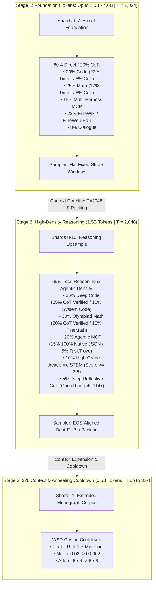

# Pulsar-300M: Stage 2 & Beyond Curriculum Specification

**Author / Maintainer:** Pulsar-300M Architecture Team  
**Hardware Profile:** Local RTX 4060 Laptop GPU (8 GB VRAM) / Single-Node NVMe ($0 Cloud Cost)  
**Curriculum Scope:** Stage 2 (High-Density Reasoning Upsample) $\to$ Intermediate Bridge $\to$ Stage 3 (32k Long-Context & WSD Annealing)

---

## 1. Executive Summary & Architectural Motivation

In Stage 1 (Foundation Pretraining), Pulsar-300M trains on a broad **80% Direct / 20% CoT** balance across Shards 1–7 at context length $T = 1,024$. The primary objective of Stage 1 is learning language grammar, vocabulary geometry, code syntax, foundational math representations, and basic tool formats.

However, a fixed 1,024-token window with flat non-overlapping slicing cannot develop sustained reasoning chains:
1. **Truncation Barrier:** The median Chain-of-Thought (CoT) problem-solution trace is 1,278 tokens. Slicing at fixed 1,024 strides cuts >62% of reasoning traces mid-derivation, forcing the model to predict next tokens without seeing the initial premise or the final resolution.
2. **Formatting Dilution:** Exposing a 300M parameter model to multiple competing tool syntax styles (XML `<invoke>`, Markdown JSON, Native JSON) splits parametric capacity.
3. **Superficial Knowledge vs. Rigorous Deduction:** Standard web corpora contain low reasoning density. Stage 2 explicitly pivots compute toward **verifiable deductive logic**.



---

## 2. Stage 2 Domain Composition & Sub-stream Quotas

Stage 2 allocates **1.50 Billion Tokens** across Shards 8, 9, and 10 ($3 \times 500\text{M}$ tokens). Every sub-stream is mathematically balanced and deterministic:

| Sub-Stream ID | Name | Pillar | Share (%) | Token Budget (3 Shards) | Primary Source | Strict Quality Filter |
| :---: | :--- | :--- | :---: | :---: | :--- | :--- |
| **`1B`** | Competitive Code (CoT) | Code | **25.0%** | 375,000,000 | `nvidia/OpenCodeReasoning` | `is_correct == True` strictly enforced |
| **`1A`** | Clean System Code (Direct) | Code | **10.0%** | 150,000,000 | `codeparrot/github-code-clean` | `strip_code_license_headers()` (SPDX/Apache/MIT removal) |
| **`2B`** | Math Reasoning (CoT) | Mathematics | **20.0%** | 300,000,000 | `nvidia/OpenMathReasoning` | `is_correct == True` strictly enforced |
| **`2A`** | Math Textbooks & Proofs | Mathematics | **10.0%** | 150,000,000 | `HuggingFaceTB/finemath` | `finemath-4plus` highest pedagogical quality |
| **`3A`** | Multi-Turn Agentic MCP | Agentic MCP | **15.0%** | 225,000,000 | `Agent-Ark/Toucan-1.5M` | **100% Native Fast JSON** (`native_only=True`) |
| **`3B`** | Structured Schemas & Tasks | Agentic MCP | **5.0%** | 75,000,000 | `open-thoughts/TaskTrove` | TOML, bash workflows, and environment states |
| **`4B`** | High-Density STEM Web | Knowledge | **10.0%** | 150,000,000 | `HuggingFaceFW/fineweb-edu` | Filtered strictly for `int_score >= 3.5` |
| **`5B`** | Deep CoT Dialogue | Conversational | **5.0%** | 75,000,000 | `open-thoughts/OpenThoughts-114k` | Normalized `<|think|>...<|/think|>` reflective traces |
| **Total** | **Stage 2 Reasoning Mix** | — | **100.0%** | **1,500,000,000** | — | **65.0% Reasoning & Agentic Traces** |

---

## 3. The 5 Core Quality & Architectural Invariants

### 1. 100% Native Fast JSON Standardization
In Stage 1, tool calls were randomized across 3 harness styles (70% Native, 15% XML `<invoke>`, 15% Markdown JSON). In Stage 2, **all multi-harness splits are deprecated in favor of 100% Native Fast JSON**:
```xml
<|tool_call|>
{"name": "fetch_weather", "arguments": {"city": "Tokyo", "units": "celsius"}}
<|/tool_call|>
```
*Rationale:* For a 300M model, syntactic consistency prevents cross-attention confusion between JSON brackets and XML tags, cementing reliable tool-call emission.

### 2. Ground-Truth Correctness Filtering (`is_correct == True`)
In synthetic reasoning datasets (`OpenCodeReasoning`, `OpenMathReasoning`), up to 18% of traces produce incorrect final solutions or failed unit tests.
- In Stage 1, all traces were included to learn vocabulary and structure.
- In Stage 2, `prepare_shards.py` strictly skips any row where `row.get("is_correct") is False`.
*Rationale:* Prevents the recurrent core from internalizing fallacious arithmetic or hallucinatory code patterns.

### 3. Automated License & Boilerplate Scrubbing
All source code files in Sub-stream `1A` pass through `strip_code_license_headers()`:
- Strips multi-line Apache 2.0, MIT, BSD, GPL, and SPDX blocks from the opening lines.
*Rationale:* Reclaims 50–120 tokens per file of pure context window bandwidth for functional logic and type signatures.

### 4. EOS-Aligned Best-Fit Bin Packing (`--sampler bestfit`)
At $T = 2,048$, Stage 2 trains exclusively with `PackedBatchLoader` from [`src/packing.py`](file:///home/yashwanth/projects/pulsar-300m/src/packing.py):
- Whole documents are placed into windows using greedy best-fit decreasing bin packing.
- Intact document presentation increases from 59.3% (flat sampler) to **100% of all documents that fit within 2,048 tokens**.
- Cross-document label masking: At every document's terminal `<|endoftext|>`, the subsequent token target is set to `ignore_index = -100`. The model is **never** penalized for not predicting the start of an unrelated packed sequence.

### 5. Hardware Invariance on 8 GB VRAM ($0.00 Cloud Spend)
Doubling the sequence length ($T = 1,024 \to T = 2,048$) preserves exact global batch dynamics and fits within the 8 GB RTX 4060 VRAM envelope:
$$\text{Global Batch Tokens} = \text{MBS} \times T \times \text{grad\_accum} = 1 \times 2,048 \times 64 = 131,072\text{ tokens / step}$$

| Dimension | Stage 1 ($T=1024$) | Stage 2 ($T=2048$) | Scaling Invariance |
| :--- | :---: | :---: | :--- |
| **Micro-Batch Size ($MBS$)** | `2` (or `3`) | **`1`** | Bounded activation memory per micro-step |
| **Sequence Length ($T$)** | `1,024` | **`2,048`** | $2\times$ context window capacity |
| **Tokens per Micro-Step** | `2,048` | **`2,048`** | **Identical activation memory footprint** |
| **Gradient Accumulation** | `64` micro-steps | **`64` micro-steps** | Exactly 64 forward/backward passes per optimizer step |
| **Global Batch Tokens** | `131,072` tokens | **`131,072` tokens** | **Identical optimizer step dynamics** |
| **Peak VRAM** | `6.8 GB` | **`~7.1 GB`** | Comfortably within 8.0 GB physical memory |

---

## 4. RoPE Frequency Invariance Across Stage Transitions

Pulsar-300M implements a dual Rotary Positional Embedding (RoPE) architecture in [`src/model.py`](file:///home/yashwanth/projects/pulsar-300m/src/model.py#L24-L26):
- **Local RoPE (6 layers):** $\theta_{\text{local}} = 10,000.0$ (high-frequency resolution for local 1,024 sliding-window attention).
- **Global RoPE (2 anchor layers):** $\theta_{\text{global}} = 1,000,000.0$ ($1\text{M}$ base theta for long-range global attention).
- **Initialization:** Both RoPE modules are initialized with `max_seq_len = 32,768`.

*Key Architectural Invariant:* Transitioning from $T = 1,024$ in Stage 1 to $T = 2,048$ in Stage 2 (and eventually $32\text{k}$ in Stage 3) requires **zero parameter interpolation, zero weight surgery, and zero YaRN re-scaling**. The global anchor layers natively represent frequencies up to 32,768 without wavelength saturation.

---

## 5. Transition Criteria: When to Launch Stage 2

We define two viable transition strategies:

### Strategy A: Full Foundation Track (4.0B Tokens)
- Continue Stage 1 through Shard 7 (30,281 steps).
- Best suited if multi-GPU cloud compute were available.
- On single local GPU: Requires ~120 GPU hours.

### Strategy B: Agile Local Fast-Track (Recommended: 1.0B Tokens)
- Shards 1 + 2 contain **952,436,152 train tokens** ($\sim 1.0\text{B}$ tokens).
- At **Step 7,266**, Pulsar-300M completes 1 full epoch over Shards 1 + 2.
- Telemetry shows the model reaches sub-`2.00` validation loss with stable representation velocity.
- Transition immediately to **Stage 2 (Shard 8, 9, 10)** at Step 7,266 with $T = 2,048$, best-fit packing, and 65% reasoning mix.

---

## 6. Execution Runbook: Building and Launching Stage 2

### Step 1: Build Stage 2 Shards (Shards 8, 9, 10)
Run locally on CPU using Rust multi-threaded tokenization (NVMe disk space required: ~1.0 GB per shard):
```bash
# Build Shard 8 (Stage 2)
python data/prepare_shards.py \
  --stage 2 \
  --shard-idx 8 \
  --total-tokens 500000000 \
  --train-path data/train_shard8.bin \
  --val-path data/val_shard8.bin \
  --batch-size 2048

# Build Shard 9 (Stage 2)
python data/prepare_shards.py \
  --stage 2 \
  --shard-idx 9 \
  --total-tokens 500000000 \
  --train-path data/train_shard9.bin \
  --val-path data/val_shard9.bin \
  --batch-size 2048

# Build Shard 10 (Stage 2)
python data/prepare_shards.py \
  --stage 2 \
  --shard-idx 10 \
  --total-tokens 500000000 \
  --train-path data/train_shard10.bin \
  --val-path data/val_shard10.bin \
  --batch-size 2048
```

### Step 2: Audit Special Token Activation
Verify that all 9 special tokens ($0..8$) are present with $>1,000$ occurrences and inspect decoded reasoning samples:
```bash
python data/audit_shard.py --shard-path data/train_shard8.bin
```

### Step 3: Launch Stage 2 Pretraining ($T=2048$, `--sampler bestfit`)
Resume directly from the Stage 1 checkpoint (`checkpoints/latest.pt`) using `--reset-dataset` to start at window 0 of Shard 8 without resetting optimizer moments:
```bash
.venv/bin/python src/train.py \
  --train-bin "data/train_shard8.bin,data/train_shard9.bin,data/train_shard10.bin" \
  --val-bin "data/val_shard8.bin,data/val_shard9.bin,data/val_shard10.bin" \
  --seq-len 2048 \
  --micro-batch-size 1 \
  --global-batch-tokens 131072 \
  --max-steps 41636 \
  --resume checkpoints/latest.pt \
  --reset-dataset \
  --sampler bestfit \
  --lr-schedule wsd \
  --muon-lr 0.02 \
  --adam-lr 6e-4 \
  --bias-lr 0.01 \
  --muon-momentum-fp32 \
  --moe-capacity-factor 1.25 \
  --eval-every 50 \
  --eval-iters 20 \
  --save-every 100 \
  --thermal-cooldown-every 100 \
  --thermal-cooldown-seconds 100 \
  --checkpoint-dir checkpoints
```

---

## 7. Stage 3: Long-Context 32k & Cosine Cooldown Annealing

### The Role of Stage 3
Stage 3 represents the **"D" (Decay) in Warmup-Stable-Decay (WSD)**:
- **Token Allocation:** Shard 11 (500M tokens).
- **Context Length:** $T \in [2,048, 32,768]$ tokens.
- **Corpus:** Full software repositories, monograph proofs, and complete multi-turn tool sessions.
- **LR Annealing:** Smooth cosine cooldown from 100% peak LR down to 1% minimum LR (`Muon: 0.02 -> 0.0002`, `Adam: 6e-4 -> 6e-6`).

### Branch Decay Evaluation Protocol (`scripts/branch_decay.py`)
Because Stage 2 operates on a stable flat plateau (100% LR), it does not undergo cooldown. To evaluate an annealed short-context checkpoint without disrupting the active pretraining trajectory:
```bash
python scripts/branch_decay.py \
  --checkpoint checkpoints/milestone_step_XXXX.pt \
  --steps 300 \
  --seq-len 2048 \
  --micro-batch-size 1 \
  --global-batch-tokens 131072 \
  --out-dir checkpoints/decay_eval_XXXX
```
This anneals a branch copy to the 1% floor, providing the true lower-bound perplexity of the Stage 2 representations while keeping the main pretraining branch completely unperturbed.
