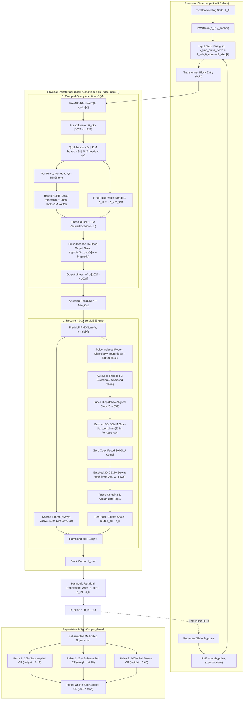

# Pulsar-300M Model Specification & Low-Level Implementation Blueprint

- **Model Name:** Pulsar
- **Architecture Type:** Recurrent Sparse Mixture-of-Experts with 32k Hybrid Attention
- **Target Parameter Count:** **299.68M Total Parameters** (`299,675,776`)
  - **Active Parameters per Token:** **147.92M parameters** (`97.59M` non-embedding active)
  - **Shared Parameters:** **98.35M parameters** (Embeddings, Attention, Shared Experts, Norms, Output Gates)
  - **Routed Expert Parameters:** **201.33M parameters** ($8 \text{ blocks} \times 8 \text{ experts} \times 3.15\text{M}$)
  - **Tied Token Embeddings:** **50.33M parameters** ($49,152 \times 1024$)
- **Precision:** Pure BFloat16 compute for 2D/3D projection matrices, strictly preserved Float32 for 1D parameters, RMSNorm scales, router weights, attention gates, and harmonic scale vectors.

---

## 1. Tensor Flow & Architecture Diagram

---

## 2. Mathematical Formulation & Recurrent State Dynamics

### 1.1 Input Stage & Embedding
For an input sequence of token IDs $X = (x_1, x_2, \dots, x_T) \in \mathbb{V}^T$, initial token embeddings are generated via tied embedding matrix $W_{\text{emb}} \in \mathbb{R}^{V \times D}$:
$$h_0 = \text{Embedding}(X; W_{\text{emb}}) \in \mathbb{R}^{B \times T \times D}$$
where $V = 49,152$ and $D = 1024$.

### 1.2 Recurrent Pulse Loop & Coordinate-Consistent State Accumulation
The physical 8-layer Transformer core is executed recurrently for $K = 3$ pulses ($k \in \{0, 1, 2\}$).

1. **Unit-Normalized Anchor & State Mixing:**
   Prior to layer entry, the prompt anchor $h_0$ and the recurrent state $h_{\text{pulse}}$ are normalized to unit variance to prevent coordinate scale mismatch:
   $$h_{0, \text{norm}} = \text{RMSNorm}(h_0; \gamma_{\text{anchor}})$$
   $$h_{\text{pulse}, \text{norm}} = \text{RMSNorm}(h_{\text{pulse}}; \gamma_{\text{pulse\_state}})$$
   $$\lambda_k = \sigma(\theta_{\text{mix}}[k]) \in \mathbb{R}^D$$
   $$h_{\text{in}} = (1 - \lambda_k) \odot h_{\text{pulse}, \text{norm}} + \lambda_k \odot h_{0, \text{norm}} + E_{\text{step}}[k]$$
   where $E_{\text{step}} \in \mathbb{R}^{K_{\text{max}} \times D}$ provides pulse-positional conditioning.

2. **Core Forward Pass:**
   The state $h_{\text{in}}$ passes sequentially through the 8 physical Transformer blocks indexed by pulse $k$:
   $$h_{\text{curr}} = \text{TransformerCore}(h_{\text{in}}, \text{pulse\_idx}=k)$$

3. **Harmonic Residual State Refinement:**
   The recurrent state is updated with a learnable per-pulse channel scaling vector $\mathbf{s}_k \in \mathbb{R}^D$:
   $$\Delta h = (h_{\text{curr}} - h_{\text{in}}) \odot \mathbf{s}_k$$
   $$h_{\text{pulse}} \leftarrow h_{\text{in}} + \Delta h$$
   where $\mathbf{s}_k$ is initialized harmonically to $\frac{1}{k + 1}$ ($1.00 \to 0.50 \to 0.33$).
   *(Initial unscaled updates produced $\|\Delta \mathbf{h}\| \approx 150$ versus $\|\mathbf{h}_{\text{in}}\| \approx 32$, overwriting early representations. Harmonic scaling strictly contracts update norms across recursion: $\|\Delta \mathbf{h}_1\| = 40.0 \to \|\Delta \mathbf{h}_2\| = 18.6 \to \|\Delta \mathbf{h}_3\| = 12.4$, guaranteeing stable multi-pulse refinement).*

---

## 3. Block Sublayer Formulations

Each of the 8 physical blocks contains a Grouped-Query Attention (GQA) sublayer and a Sparse Mixture-of-Experts (MoE) sublayer, conditioned on pulse index $k$.

### 2.1 Grouped-Query Attention (GQA) with QK-Norm & Value Residual

1. **Pre-Attention Normalization:**
   $$x_{\text{attn}} = \text{RMSNorm}(h; \gamma_{\text{attn\_norm}}[k])$$

2. **Fused Projection ($W_{qkv} \in \mathbb{R}^{D \times (D_Q + 2 D_{KV})}$):**
   $$Q, K_{\text{raw}}, V_{\text{raw}} = x_{\text{attn}} W_{qkv}$$
   where $D_Q = 16 \times 64 = 1024$ and $D_{KV} = 4 \times 64 = 256$ ($4:1$ GQA ratio).

3. **Per-Pulse, Per-Head QK-RMSNorm:**
   $$Q_{\text{norm}} = \text{RMSNorm}(Q) \odot \gamma_Q[k, h_Q]$$
   $$K_{\text{norm}} = \text{RMSNorm}(K_{\text{raw}}) \odot \gamma_K[k, h_{KV}]$$
   where $\gamma_Q \in \mathbb{R}^{8 \times 16 \times 64}$ and $\gamma_K \in \mathbb{R}^{8 \times 4 \times 64}$ are FP32 trainable scale factors.

4. **32k Hybrid Local / Global RoPE:**
   - **Local Layers ($l \in \{0, 1, 2, 4, 5, 6\}$):** Apply RoPE with $\theta = 10,000$, evaluated within a sliding window of $1024$ tokens.
   - **Global Anchor Layers ($l \in \{3, 7\}$):** Apply RoPE with $\theta = 1,000,000$, attending over the full causal sequence span ($T \le 32,768$) with YaRN temperature scaling:
     $$Q_{\text{scaled}} = Q_{\text{norm}} \cdot \left(1.0 + 0.1 \cdot \ln\frac{T}{1024}\right) \quad \text{for } T > 1024$$

5. **First-Pulse Value-Residual Skip ($v_{\text{first}}$):**
   - At Layer 0, Pulse 0: $V_{\text{first}} = V_{\text{raw}}$.
   - For all subsequent layers/pulses:
     $$\lambda_v = \sigma(\theta_v[k])$$
     $$V = (1 - \lambda_v) V_{\text{raw}} + \lambda_v V_{\text{first}}$$

6. **Flash Causal Attention & Pulse-Indexed 16-Head Output Gate:**
   $$O = \text{SDPA}(Q, K, V, \text{is\_causal}=\text{True}) \in \mathbb{R}^{B \times H_Q \times T \times d_{\text{head}}}$$
   Each of the 16 attention heads is dynamically gated per pulse:
   $$\mathbf{g}_k = \sigma(x_{\text{attn}} W_{\text{gate}}[k]^\top + b_{\text{gate}}[k]) \in \mathbb{R}^{B \times T \times 16}$$
   where $W_{\text{gate}} \in \mathbb{R}^{K_{\text{max}} \times 16 \times D}$ and $b_{\text{gate}} \in \mathbb{R}^{K_{\text{max}} \times 16}$ ($b_{\text{gate}}$ initialized to `2.0` so $\sigma(2.0) \approx 0.88$, starting all heads open).
   $$O_{\text{gated}}[:, h, :, :] = O[:, h, :, :] \cdot \mathbf{g}_k[:, :, h, \text{None}]$$
   $$h \leftarrow h + \text{reshape}(O_{\text{gated}}) W_o \quad (W_o \in \mathbb{R}^{D \times D})$$
   *(Eliminates Softmax attention-sink noise by allowing heads to throttle output mass smoothly toward $0.0$, operating with 0% FlashAttention latency penalty).*

---

### 2.2 Sparse Mixture-of-Experts (MoE) Sublayer

1. **Pre-MLP Normalization:**
   $$x_{\text{mlp}} = \text{RMSNorm}(h; \gamma_{\text{mlp\_norm}}[k])$$

2. **Pulse-Indexed Router & Auxiliary-Loss-Free Selection:**
   $$\text{logits} = x_{\text{mlp}} W_{\text{router}}[k] \in \mathbb{R}^{N \times 8}$$
   $$s = \sigma(\text{logits}) \in \mathbb{R}^{N \times 8}$$
   $$\text{Top-}2 = \operatorname{argtop2}(s + b)$$
   where $b \in \mathbb{R}^8$ is the adaptive bias vector updated via:
   $$b_i \leftarrow b_i + 0.001 \cdot \operatorname{sign}(\bar{C} - C_i)$$
   Unbiased weights are normalized across the selected Top-2:
   $$w_i = \frac{s_i}{\sum_{j \in \text{Top-}2} s_j}, \quad i \in \text{Top-}2$$

3. **1 Shared Expert (Always Active):**
   $$\text{shared\_out} = \text{SwiGLU}(x_{\text{mlp}} W_{\text{sh\_gu}}) W_{\text{sh\_down}}$$
   where $W_{\text{sh\_gu}} \in \mathbb{R}^{1024 \times 2048}$ and $W_{\text{sh\_down}} \in \mathbb{R}^{1024 \times 1024}$.

4. **8 Routed Experts via Batched 3D GEMM:**
   Tokens are dispatched into expert slots with aligned capacity ($C = 832$ at $MBS=3$):
   $$\text{gu} = \text{torch.bmm}(\text{expert\_inputs}, W_{\text{routed\_gu}}) \in \mathbb{R}^{8 \times C \times 2048}$$
   $$\text{act} = \text{FusedSwiGLU}(\text{gu}, d_{\text{ff}}=1024) \in \mathbb{R}^{8 \times C \times 1024}$$
   $$\text{exp\_out} = \text{torch.bmm}(\text{act}, W_{\text{routed\_down}}) \in \mathbb{R}^{8 \times C \times 1024}$$

5. **Per-Pulse Routed Expert Scaling & Fused Output Combination:**
   Routed expert outputs are scaled channel-wise by a learnable per-pulse scale vector $\mathbf{r}_k \in \mathbb{R}^D$ (initialized to `1.0`), then combined with the shared expert residual:
   $$y = \text{SharedExpert}(x_{\text{mlp}}) + \left(\sum_{j \in \text{Top-}2} w_j \cdot \text{exp\_out}_j\right) \odot \mathbf{r}_k$$
   $$h \leftarrow h + y$$

---

## 4. Custom Fused CUDA Kernels (`csrc/kernels.cu`)

All latency-critical primitives are implemented in pure CUDA C++ with PyBind11 bindings in `pulsar_cuda`:

| Kernel Function | Launch Geometry | Optimizations & Invariants |
| :--- | :--- | :--- |
| **`rmsnorm_forward_vec8_kernel`** | `threads = 128`, `blocks = N` | Exact 4-warp alignment ($1024 / 8 = 128$). Vectorized 128-bit `uint4` loads. |
| **`rmsnorm_backward_vec8_kernel`** | `threads = 128`, `blocks = N` | Thread-register accumulation across rows, single atomic write at exit. |
| **`qk_rmsnorm_forward_kernel`** | `threads = 64`, `blocks = (N, H)` | Warp-specialized for $d_{\text{head}} = 64$ ($2 \times 32$ threads). Zero idle lanes. |
| **`qk_rmsnorm_backward_kernel`** | Grid-stride 2D loop | Thread registers accumulate $dw_Q$ and $dw_K$ across all tokens. Eliminates atomic contention (**10.5x speedup**). |
| **`moe_router_topk_kernel`** | `threads = 128`, `blocks = (N + 127)/128` | Fused evaluation of `sigmoid(logits)`, bias addition, Top-2 selection, unbiased normalization, and row `logsumexp` z-loss in registers. |
| **`fused_swiglu_forward/bwd`** | `threads = 256`, 1D grid | Direct strided reads/writes on contiguous `[..., 2048]` tensors. Zero `.chunk(2)` and zero `torch.cat`. |
| **`moe_dispatch / combine`** | Aligned capacity kernels | Parallel index gather/scatter directly into 3D batch matrices. |
| **`fused_softcap_ce`** | Online softmax with soft-capping | Evaluates $30.0 \times \tanh(\text{logits}/30.0)$ directly inside the cross-entropy kernel without allocating huge $B \times T \times V$ FP32 activation tensors. |

---

## 5. Multi-Step Deep Supervision with Rotating Subsampling

Pulsar employs deep supervision across all $K=3$ recurrent passes during pretraining:

$$\mathcal{L}_{\text{total}} = 0.15 \cdot \mathcal{L}_{\text{pulse1}} + 0.25 \cdot \mathcal{L}_{\text{pulse2}} + 0.60 \cdot \mathcal{L}_{\text{pulse3}} + \mathcal{L}_z$$

- **Intermediate Pulses ($k \in \{0, 1\}$):** Subsamples 25% of tokens with rotating disjoint offsets:
  $$\text{offset} = (\text{subsample\_offset} + k) \pmod 4$$
  $$h_{\text{sub}} = h_{\text{pulse}}[:, \text{offset}::4, :]$$
  Reduces vocabulary projection GEMMs ($[N, 1024] \times [1024, 49152]$) and cross-entropy allocations by **75%** on Pulses 1 & 2.
- **Final Pulse ($k = 2$):** Evaluates 100% of tokens to ensure global pretraining loss calibration.
- **Logit Soft-Capping:** All logits are bounded to $[-30.0, 30.0]$ via $30.0 \times \tanh(\text{logits} / 30.0)$, preventing entropy collapse and logit drifting.

---

## 6. Shape-Grouped Muon Optimizer Geometry

Pulsar uses a dual-optimizer engine designed for recurrent MoE models:

1. **`opt_muon` (Matrix Parameters — 247.46M params):**
   - Updates all 2D Attention projections ($W_{qkv}, W_o$) and MLP matrices.
   - **Batched 3D GEMM Orthogonalization:** The 64 routed expert matrices are grouped into two 3D tensors:
     - `w_gate_up`: shape `[64, 1024, 2048]`
     - `w_down`: shape `[64, 1024, 1024]`
     Newton-Schulz iteration (degree 5) evaluates all 64 experts in parallel using batched matrix multiplications, eliminating 64 individual kernel launch overheads.
   - Base learning rate: $\eta_{\text{muon}} = 0.02$, momentum $= 0.95$, weight decay $= 0.1$.

2. **`opt_adam` (1D Parameters, Embeddings, Routers, Gates & Scales — 52.21M params):**
   - Updates `tok_emb` (50.33M), `pulse_step_emb`, `router_weight` (0.52M), `input_mix_logit`, `attn_gate` (1.05M), `attn_gate_bias`, `pulse_res_scale`, `routed_scale`, and all RMSNorm scale parameters.
   - All 1D/norm parameters, router weights, attention gates/biases, and per-pulse scales are strictly preserved in **`torch.float32`** throughout forward, backward, and optimizer updates to guarantee numerical stability.
   - Base learning rate: $\eta_{\text{adam}} = 6 \times 10^{-4}$, $\beta = (0.9, 0.95)$, weight decay $= 0.0$.
